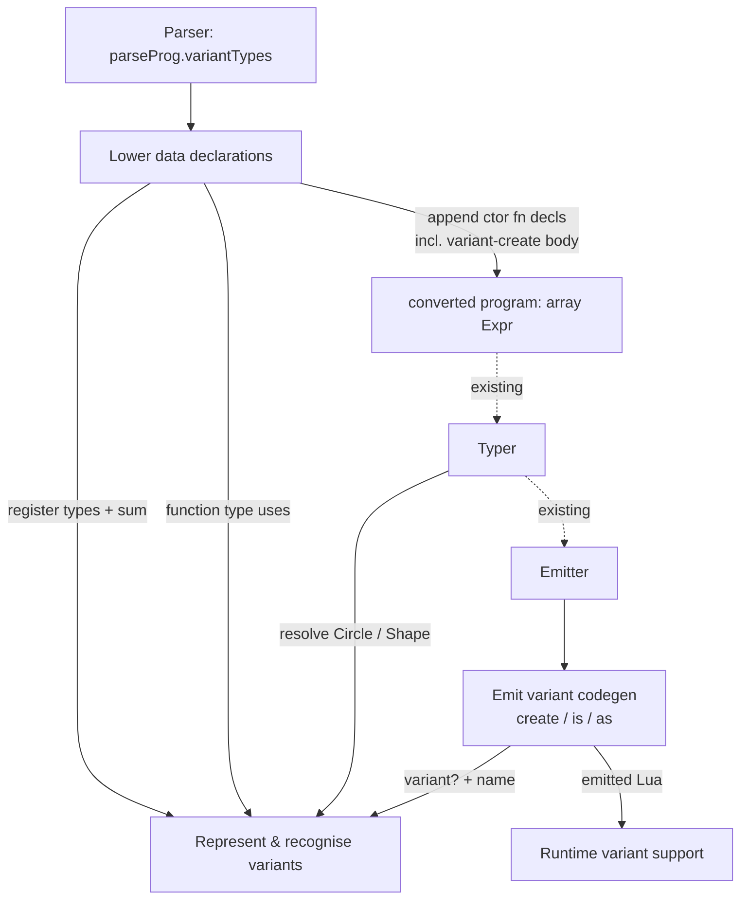

# Variant (`data`) constructors — architecture

GitHub issue #14. Self-hosted compiler `chicc`. This is the **Phase 1** artifact of an excavation flow (diagram → signatures → signature-fit → tests → bodies); later "Phase N" references point at those steps.

## Goal & non-goals

**Goal:** make the issue's repro compile *and run* end-to-end:

```chi
data Shape = Circle(r: int) | Rect(w: int, h: int)
fn area(s: Shape): int {
    if s is Circle { val c = s as Circle; c.r * c.r * 3 }
    else           { val r = s as Rect;   r.w * r.h }
}
println(area(Circle(2)))
println(area(Rect(3, 4)))
```

Four things must work together:
1. **Construction** — `Circle(2)` resolves and builds a value.
2. **Discrimination** — `s is Circle` returns the right bool at runtime.
3. **Cast** — `s as Circle` yields a value typed as `Circle`, so field access type-checks.
4. **Field access** — `c.r` works via the existing structural record machinery.

**Non-goals (deferred — see Open Questions):**
- Flow-narrowing (`if s is Circle { /* s usable as Circle without `as` */ }`).
- Exhaustiveness checking over variants.
- Generic variants (`data Option[T] = Some(T) | None`). The parser accepts type params; we do **not** commit to typing them. The lowering must refuse them with a clear diagnostic rather than miscompile (Open Question 4).
- **Recursive variants** (`data List = Cons(head: int, tail: List) | Nil(...)`). Discovered in Phase 5: lowering registers plain records/sums, so a self/sibling reference forms a cyclic type the typer cannot fold (stack overflow). Type aliases avoid this via `resolveTypeAndWrapRecursive`; variants would need the equivalent. Out of scope — lowering detects a field referencing the data type or a sibling constructor and rejects with `UNSUPPORTED_FEATURE` (follow-up issue).
- Checked `as` (runtime error on tag mismatch). This issue emits an unchecked passthrough; the repro guards every cast with `is`.

## Design decisions (from Phase 0)

- **Scope:** full repro end-to-end.
- **Runtime representation:** each constructor produces a Lua table with a **per-variant metatable** carrying the variant name. Discrimination (`is`/`as`) inspects the metatable — same shape as the existing `chi_is_record`/`chi_is_array` discrimination helpers. No visible tag field.
- **Type identity:** *hybrid*. Discrimination is **nominal** — the variant name, carried as the `TypeId.name` of the constructor's record type, mirrored at runtime by the metatable's `variantName`. Field access stays **structural** (a variant value is a record with fields). The nominal part is exactly one name; everything else is the existing structural record behavior.

## Key reuse insight

A constructor is **a named function whose body builds a tagged record**. The *pieces* of `convertFuncWithNameImpl` (ast_converter.chi:420) are reusable individually — `functionType` from params+return, a `FnSymbolTable` for the body, `addLocalSymbol` (ast_converter.chi:486), `nameDeclarationExpr(fnExpr(body))`. But Phase 3 found the *function itself* cannot be reused: it is driven end-to-end by parse-AST accessors (`node.paName()`, `node.paFormalArguments()`, `node.paFuncBody()`) and its record path goes through `createRecordExpr`, which drops `variantName`. A synthesised constructor has no parse node and needs a `createVariantExpr` body, so `lowerVariantTypes` **hand-assembles** the `newFnParam` + `FnSymbolTable` + `fnExpr` + `nameDeclarationExpr` + `addLocalSymbol` tail (~10 lines) rather than calling `convertFuncWithNameImpl`. The genuinely new work: (a) registering the nominal constructor types + the data sum, (b) the tagged record-creation, (c) the variant branches in `is` codegen.

**Failure channel.** `lowerVariantTypes` returns `array[Expr]`; it signals rejection (generic variant, duplicate ctor name, unresolved field type) the same way the rest of conversion does — by throwing a structured error `embedLua("error({ code = '…', text = '…' })")`, which `compile` catches in the `pcall` around `convertProgram` (compiler.chi:595-605) and surfaces as a clean compiler message. No return-type channel needed.

## Logical modules

Four **responsibilities** (not files, not AST nodes). Physical mapping — mostly into existing `ast_converter.chi`, `types.chi`, `emitter.chi`, `runtime/chi_runtime.lua` — emerges in Phase 2.

- **Lower `data` declarations.** Consume `parseProg.variantTypes` and, per declaration, drive the other three responsibilities: ask *Represent variants* to register the constructor types and the sum, then for each constructor materialise a function declaration — build its param list from the constructor's `FormalField`s, type it `(fieldTypes…) -> dataSum`, register the symbol, and emit `nameDeclarationExpr(fnExpr(body))`. The `body` is `createVariantExpr(fields, variantName)` — **not a new node kind**: Phase 2 found it is a `create_record` with a `variantName` string field set (ast.chi). Discrimination (`is`/`as`) keys on the *resolved variant type*, not on this field, so no new typer/emitter dispatch kind is needed. Runs at the point in `convertProgram` where type aliases are registered (ast_converter.chi:941-978), **before** code conversion, so casts and annotations resolve regardless of source order.

- **Represent & recognise variants.** The type-level model. Per declaration: build one nominal `record` type per constructor (structural fields + a variant marker tying it to its name) and compose the data type as the `sum` of them (`sumType`, types.chi:80). Register both into the type table so `Circle`/`Shape` resolve as type names. Exposes the predicate the codegen keys on: *given a `Type`, is it a variant, and what is its name?* (`variantNameOf(type): string | unit`).

- **Emit variant codegen.** All emitter-side work, keyed on `variantNameOf`: (1) the variant-create node → build the Lua table and `setmetatable` it to the constructor's per-variant metatable (mirrors `emitCreateRecord`, emitter.chi:638, which sets `record_meta_table`); (2) `emitIs` (emitter.chi:727) → when the checked type is a variant, emit a metatable-name check instead of `chi_is_record`; (3) `emitCast` (emitter.chi:596) → when the target is a variant, passthrough the value (the typer already gives the cast its target type, typer.chi:598).

- **Runtime variant support.** In `runtime/chi_runtime.lua`: a per-variant metatable factory/registry and a `chi_is_variant(value, name)` helper, paralleling `record_meta_table` + `chi_is_record` (chi_runtime.lua:123).

## Diagram

Solid arrows are new edges this feature adds; dashed arrows are existing pipeline context.



## Edge annotation table

Every edge is synchronous (single-pass compiler) with no retries — so those columns are omitted. "Failure owner" = which responsibility must produce a clear diagnostic if the payload is bad. Existing-pipeline edges (dashed) are listed for completeness but are out of scope.

| From | To | Payload | Failure owner |
|------|----|---------|---------------|
| Parser | Lower | `parseProg.variantTypes : array[ParseVariantTypeDefinition]` | Parser (syntax already validated) |
| Lower | Represent | per decl: type name, `constructors : array[VariantConstructor]` (each `.fields : array[FormalField]`), type params → register nominal records + sum | Lower (duplicate ctor name; unresolved field type; type params present → unsupported) |
| Lower | Represent | per ctor: resolved field types → `functionType((fields…) -> sum)` | Lower (field typeRef won't resolve) |
| Lower | converted program | `nameDeclarationExpr(fnExpr(variant-create body))` (`Expr`) per ctor | Lower |
| converted program | Typer *(existing)* | `array[Expr]` incl. ctor decls | Typer (existing resolution errors) |
| Typer | Represent | type name `Circle`/`Shape` → resolved `Type` | Typer (UNRECOGNIZED_TYPE if not registered) |
| Typer | Emitter *(existing)* | typed `array[Expr]` | Emitter |
| Emitter | Emit variant codegen | variant-create / `is` / `cast` `Expr` with resolved types | Emitter |
| Emit variant codegen | Represent | checked/target `Type` → `variantNameOf` | Emit variant codegen |
| Emit variant codegen | Runtime | emitted Lua: `setmetatable(t, <variant meta>)`, `chi_is_variant(v,"Circle")` | Runtime (helper must exist) |

## State ownership

| State | Owner (sole writer) | Consistency boundary |
|-------|---------------------|----------------------|
| Type table — nominal constructor types + data sum types | **Lower** (the only writer; *Represent* reads it to answer `variantNameOf`) | All types of a `data` decl written before any code conversion, so `as`/`: Shape` resolve regardless of source order. Same ordering already used for type aliases (ast_converter.chi:941). |
| Local symbol table — constructor function symbols | existing `addLocalSymbol` path | Symbol registered before body conversion (reuses the function path). |
| Per-variant metatables in emitted Lua | **Runtime** (memoised by `chi_variant_meta(name)`) | One metatable per variant name, cached in the runtime; the emitter only emits calls, never definitions (Open Question 2, resolved). |

## Open questions

1. **How `variantNameOf` marks a variant.** ✅ **RESOLVED (Phase 2, CORRECTED in Phase 5).** Phase 2 proposed *non-empty `ids`* as the marker. **That was wrong** — Phase 5 testing found type *aliases* also get non-empty `ids` (the alias post-processing at compiler.chi:566 prepends the alias `typeId` into the record's `ids`). So `ids` cannot distinguish a variant record from an alias record, and `is PackageDefinition` (an alias) misfired into the variant path. The working marker is the record's **`name` field**: variant lowering sets `rec.name = ctorName`; plain records and aliases leave `name == ""`. `variantNameOf(t)` = `t.tag == "record" && t.name != "" ? t.name : unit`. Safe because record unification/`typeEquals` iterate fields only and ignore `name` (unification.chi:357-386), so a constructor's plain-record body (name "") still unifies with its named return type. `name` is not preserved by `mapType`, but the `is`/`as` checked/target type is resolved from the alias and passed through the typer without `mapType`, so it survives where it matters.
2. **Where per-variant metatables are emitted.** ✅ **RESOLVED (Phase 2).** Nowhere special — a memoised runtime factory `chi_variant_meta(name)` builds (and caches) a metatable cloning `record_meta_table` + a `variantName` field. The emitter only emits calls: `setmetatable(t, chi_variant_meta("Circle"))` and `chi_is_variant(v, "Circle")`. Cloning `record_meta_table` keeps `isRecord`/`__eq`/`__index` behavior so variant values are still valid records for field access and equality.
3. **Sum assignability.** ✅ **RESOLVED (Phase 2, empirically).** A standalone probe (`type A={x:int}; type B={y:int}; type AB=A|B; fn f(v:AB)…; f(a)`) compiled and ran — a record-typed value *is* accepted where a sum-of-records is expected. **The typer needs no change for assignability.** The same probe also confirmed the bug's root cause directly: `f(b)` returned `unit` because `b is A` emits `chi_is_record(b)` (true for *every* record) — exactly the discrimination gap this issue fixes.
4. **Generic variants** — out of scope, but *Lower* must not miscompile a `data` decl with type params; it must emit a clear "unsupported" diagnostic.

## Phase 5 implementation hazards (locked by the signature-fit review)

The signatures hold, but the signature-fit trace (03-signature-fit.md) found body-level traps the types do **not** prevent. The implementer must honor each:

1. **`emitIs` same-tag short-circuit (B2).** `emitIs` returns the literal `"true"` when `valueTag == checkedTag` and the tag is non-primitive (emitter.chi:739-747). For `record is OtherVariant` (e.g. a value already typed as a variant record) this fires *before* any variant logic and mis-emits `true`. The variant branch (`variantNameOf(checkedType) != unit → chi_is_variant(v, name)`) must be **hoisted above** the same-tag short-circuit.
2. **Use `sumType`, not `sumCreate` (E1).** `sumCreate` (types.chi:354) dedups branches via `typeEquals`, which ignores `ids` — so two structurally-identical variants (`Celsius(degrees:int)` / `Fahrenheit(degrees:int)`) collapse into one branch and one is silently dropped from the data type. Compose the sum with raw `sumType` (types.chi:80).
3. **Runtime tag comes from `createVariantExpr.variantName`, never from the value's type (A1).** The constructor body's `create_record` is typed with empty `ids` (typer.chi:276), so `expr.exprType` is tagless. `emitCreateRecord` must read `exprVariantName(expr)` and emit `setmetatable(t, chi_variant_meta(name))` when it is non-empty; do not try to derive the tag from the type.
4. **Every record-reconstruction path must thread `t.ids` (C2/E2).** The nominal identity lives only in `ids` + `variantNameOf` + `emitIs`; `typeEquals`/unification ignore `ids` (by design — structural fields, nominal/runtime discrimination). The existing reconstruction sites already preserve `t.ids`; any new one that rebuilds with `[]` silently loses the tag.
5. **Runtime helpers do not exist yet.** Add `chi_variant_meta(name)` (memoised, clones `record_meta_table` + `variantName`) and `chi_is_variant(value, name)` to `runtime/chi_runtime.lua`.

### Phase 5 — bodies (implemented, verified)

Implemented across `runtime/chi_runtime.lua` (`chi_variant_meta` memoised factory + `chi_is_variant`), `types.chi` (`variantNameOf` via record `name`), `emitter.chi` (`emitCreateRecord` variant metatable + `emitIs` variant branch hoisted above the same-tag short-circuit), `ast.chi` (`variantName` field + `createVariantExpr`), `ast_converter.chi` (`lowerVariantTypes`), `compiler.chi` (call before `checkNames` + prepend decls).

**Two issues found during implementation (not in any prior phase):**
1. **`checkNames` ordering.** `compile` runs `checkNames` on the parse AST and bails before `convertProgram` if any name is unresolved. Constructor calls (`Circle(2)`) failed there because lowering ran inside `convertProgram` (too late). Fix: lowering moved to `compile` *before* `checkNames`, registering symbols/types up front; its declarations are prepended to the converted code. (The signature-fit review traced through `convertProgram` but not the earlier `checkNames` gate.)
2. **`ids` marker was wrong** — see Open Question 1 (corrected to record `name`).

**Phase 5 self-review (per-module simplification):**
- `lowerVariantTypes` was first written two-pass (pre-register empty records, then fill) to support recursion. Recursion turned out to stack-overflow the typer, so it is now rejected — which removed the reason for pre-registration. Simplified to single-pass: resolve fields → build complete records → build sum → build constructor decls. No empty-record placeholder, no cyclic object.
- The recursion guard is a compact recursive Lua walker over the field `typeRef`s; rejecting up front is simpler and safer than wrapping recursive types (deferred).
- Runtime helpers kept separate from the emitter (different language/file, distinct failure mode), as decided in Phase 1 Round 3.

**Verification:** issue repro runs (`12`/`12`); 10/10 contract tests pass; overlapping shapes, single-constructor form, generic rejection, and recursive rejection all behave; full suite 38/46 (the 8 failures are pre-existing environment/bootstrap failures, identical to the clean-HEAD baseline); fixed-point stable (three-generation self-rebuild identical).

## Self-Review

**Round 1 (cold re-read, subagent).** Flagged: module list mixed responsibilities with data-structures/AST-nodes (`TypeModel`, `TaggedRecordCreate`); fuzzy `VariantRegistrar`/`ConstructorDecl` split; `TaggedRecordCreate` a pure pass-through; dead `Sync`/`Retry` edge-table columns; missing `TY→EM` edge row; merged runtime row; `isRecord` vs `chi_is_record` used loosely; wrong `emitCreateRecord` line ref (638, not 651); inconsistent `FormalField`/`VariantConstructor` naming; "no typer change" claim undercut by open sum-assignability question.

**Round 2 (regenerate).** Collapsed 6 boxes → 4 responsibilities (verbs): *Lower data declarations*, *Represent & recognise variants*, *Emit variant codegen*, *Runtime variant support*. The variant-create AST node is now described as an artifact of *Lower*, not a peer module. Dropped `Sync`/`Retry` columns; split the merged runtime edge into a single codegen→runtime row with both payloads; marked existing-pipeline edges dashed and added the `Typer→Emitter` row. Fixed line refs and `FormalField`/`VariantConstructor` naming. Softened the typer claim: no change *iff* OQ3 confirms sum assignability, otherwise real work — and promoted OQ3 to "verify first."

### Phase 2 — signatures (stubs landed, build green)

New surface, all compiling (rebuilt `chicc.lua` via `run_chicc.sh compile.chi`):
- `types.chi`: `variantNameOf(t: Type): string | unit` — fully implemented (the contract: `record` with non-empty `ids` → `ids[1].name`, else unit).
- `ast.chi`: `variantName: string` field on `Expr` (default `""`), `createVariantExpr(fields, variantName, section)`, `exprVariantName`.
- `ast_converter.chi`: `lowerVariantTypes(parseProg, pkg, tables): array[Expr]` stubbed `[]`, wired into `convertProgram` after alias registration / before code conversion.

**Phase 2 self-review.** No parameter is supplied-but-unused; no return type richer than callers need (`variantNameOf`'s `string|unit` is exactly the variant/not-variant answer). The biggest subtraction: Phase 1 assumed a new AST node kind + typer/emitter dispatch; Phase 2 collapsed it to a `create_record` carrying `variantName`, because discrimination keys on the *resolved type* (which already has the nominal `ids`), not on the value's construction node. Net new dispatch: zero.

**Build/test status.** Build via native `chi`/`make` is broken in this environment (pre-existing, reproduces on clean HEAD) — use `run_chicc.sh`. 3 tests (`test_symbols`, `test_parser_stmts`, `test_typer`) fail identically on clean HEAD under the run_chicc.sh bootstrap; not regressions.

### Round 3 (simplify, Phase 1)

**Round 3 (simplify).** Considered merging *Runtime variant support* into *Emit variant codegen* (it is only two Lua helpers) — kept separate because it is a different language/file with its own failure mode (helper missing at runtime), a real boundary. Considered merging *Represent* into *Lower* — kept separate because *Emit variant codegen* also queries *Represent* (`variantNameOf`) without going through *Lower*; merging would force codegen to depend on the lowering responsibility for a pure query. No further indirection to remove; the four responsibilities each have a distinct caller set.
